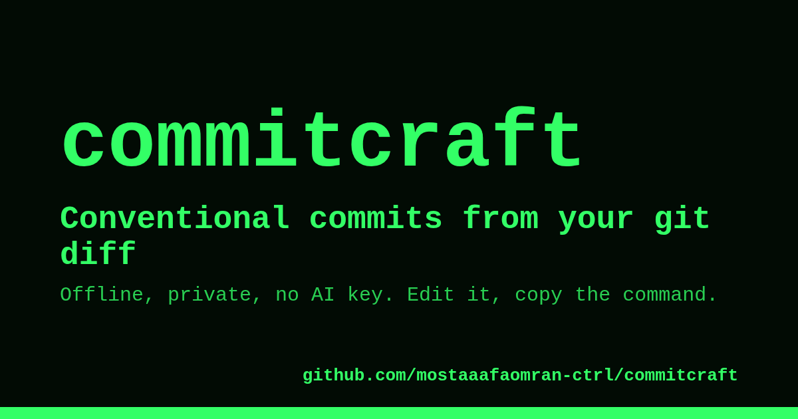

# commitcraft

Conventional commit message generator from a git diff.

**Live:** https://mostaaafaomran-ctrl.github.io/commitcraft/

## What it does

- Detects type (feat, fix, docs, test, ci, chore, refactor, style) from the files and changes
- Guesses scope from the folder and subject from new functions and file names
- Edit every part, optional file list as the body
- Copy the message or a ready git commit command

## Use it

Open the live link. No signup, no server. To run it locally, clone the repo and open `index.html` in a browser.

## بالعربي

الصق الـgit diff واحصل على رسالة commit بصيغة Conventional Commits، من غير ما الكود يطلع من المتصفح.

## License

MIT
